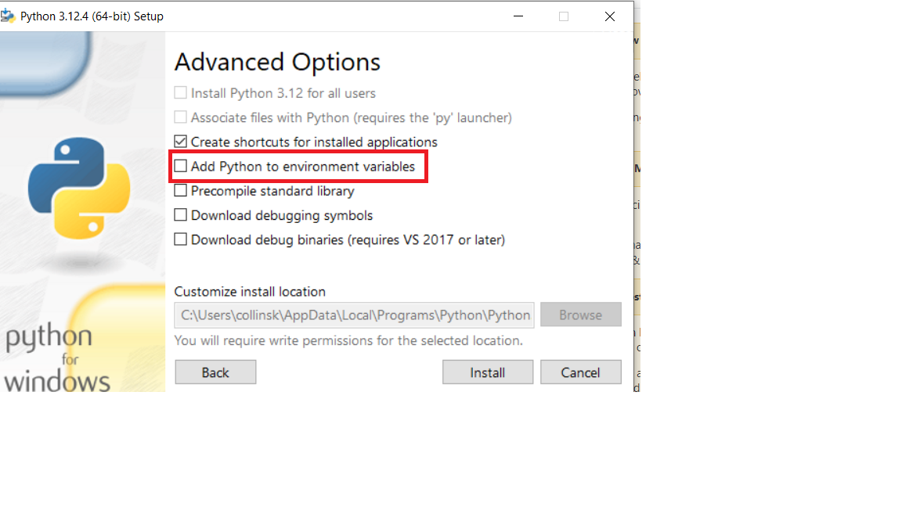
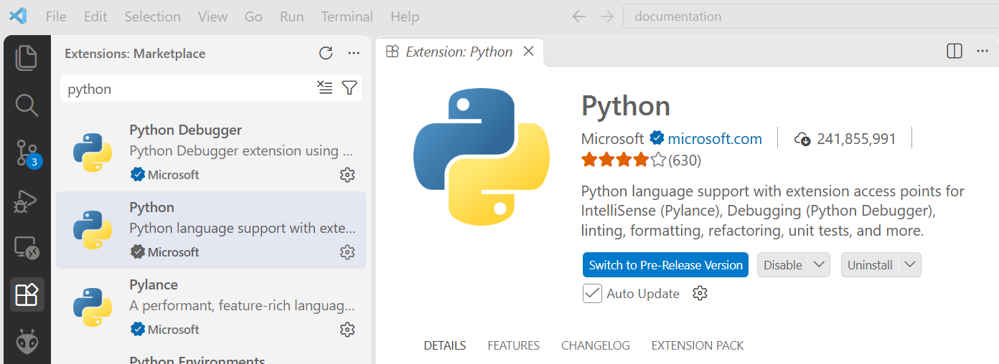
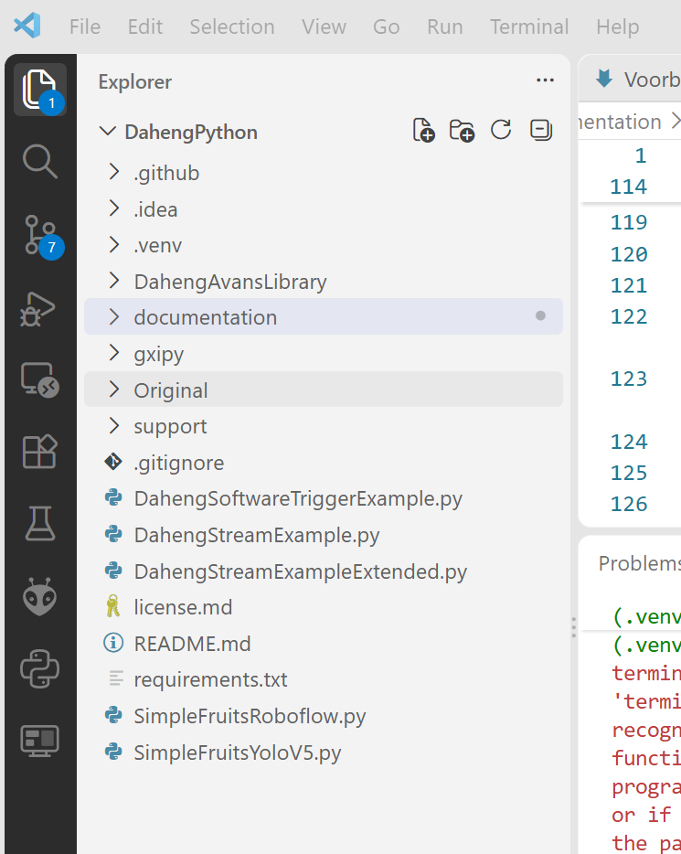
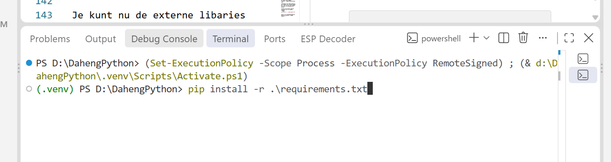

# Voorbereidingen(Visual Studio Code)


## Installatie Daheng Camera Drivers
Download de laatste versie van de Daheng Camera Drivers vanaf de [Daheng-website](https://en.daheng-imaging.com/list-59-1.html)
Installeer de volgende twee pakketten
1. Galaxy Windows SDK
2. Galaxy Windows Runtime SDK(???)

## Installatie Python

:::{warning} Belangrijk
De opdrachten in deze workshop werken alleen met versie 3.12 van Python.
:::

::::{tab-set}

:::{tab-item} Microsoft store


Open een windows console of PowerShell en voer het volgende commando uit om Python te installeren:

```powershell
winget install --id Python.Python.3.12 --source winget --force
``` 


:::

:::{tab-item} Python Website

Download de versie 3.12 van Python vanaf de [Python-website](https://www.python.org/downloads/).
Voer de installatie uit!
>Let op: 
>* Vink "Add Python to PATH" aan (belangrijk!)
>* Onthoud de installatie-locatie 




:::

::::

## Installatie Visual Code
Visual Code is een Integrated Development Environment om eenvoudig Python programma's te ontwikkelen.
Download de laatste versie van Visual Code vanaf de [Visual Code-website](https://code.visualstudio.com/)
Voer de installatie uit!

:::{warning} Belangrijk
Visual Code moet correct worden geïnstalleerd om Python-programma's te kunnen ontwikkelen.
::: 

### Installatie Visual Code-extensie voor Python
Installeer in Visual Code de Python-extensie om eenvoudig Python-programma's te kunnen ontwikkelen.

Ga naar de extensies-sectie in Visual Code, zoek naar "Python" en klik op "Installeren".



## Verkrijgen van de Avans Camera Library voor Python
Je kunt de Library op twee manieren verkrijgen:
* Download als zip-bestand, er is nog geen versiebeheer met bijvoorbeeld GitHub mogelijk
* Fork maken in GitHub, hierna is de Library beschikbaar in je eigen GitHub account en kun je versiebeheer met Git uitvoeren.

:::::{card} 
::::{tab-set}
:::{tab-item} Zip-file
[Download DahengPython Library](https://github.com/AvansMechatronica/DahengPython/archive/refs/heads/main.zip)
Pak het bestand uit in een voor jou bekende map.
:::
:::{tab-item} Git
* Maak een account aan bij [GitHub](https://github.com/) en login op dit account.

* Open de [DahengPython library](https://github.com/AvansMechatronica/DahengPython) repository

* Maak een Fork van de repository naar je eigen GitHub account door op het **Fork icoon** te klikken:


* Volg de instructies, maar wijzig de naam van de nieuwe repository niet. Bevestig met **Create Fork**

Navigeer in een command-console(cmd) naar een voor jou bekende map. Je kunt je repository verkrijgen door het volgende commando:
```cmd
git clone https://github.com/<jouw_account_naam>/DahengPython
```

Je kunt vervolgens versiebeheer doen met de volgende command-console(cmd) commando's
* git add .
* git commit -m "jouw bericht"
* git push
>Let op: Het gebruik van Git wordt hier niet nader uitgelegd. Je kunt deze site raadplagen [Git Tutorial](https://www.w3schools.com/git/?utm_source=chatgpt.com)

:::
::::
:::::

## Python Environment
Een Python-environment (omgeving) is eigenlijk een afzonderlijke “werkruimte” voor Python waarin je je programma’s draait en afhankelijkheden (libraries) installeert.

Visual Code maakt gebruik van virtuele environments:
* Een lokaal, geïsoleerd Python-systeem voor één project.
* Je installeert libraries alleen binnen dat environment.

### Project openen
Start het Visual Code programma en open met het programma de map van de DahengPython. Deze map noemen we Project.
Als je de juiste map hebt geselecteerd zie je alleen de *DahengPython* map met onderliggende mappen en bestanden, zie afbeelding hieronder.


### Maken van virtuele environment
Open de Python-environment selector in Visual Code om de virtuele omgeving te activeren. Kies voor Python 3.12 als je ook andere versies van Python op je systeem hebt geïnstalleerd.

:::{note}
- Kies `Custom`
- Bevestig de locatie `.venv`.
- Skip package installation
:::

>Er is nu een map ".venv" in je Project gemaakt

### Installeren van benodigde externe libraries
Open de Visual Code(`Terminal-->New Terminal`) terminal window.



>Controleer of de regel waarop je een commando kunt uitvoeren begint met (.venv). Zo niet sluit Visual Code af en start het programma weer opnieuw.

Je kunt nu de externe libraries installeren met het volgende commando
```bash
pip install -r .\requirements.txt
```

Hierna is de programmeeromgeving gereed voor gebruik. 😃Happy coding !!!

